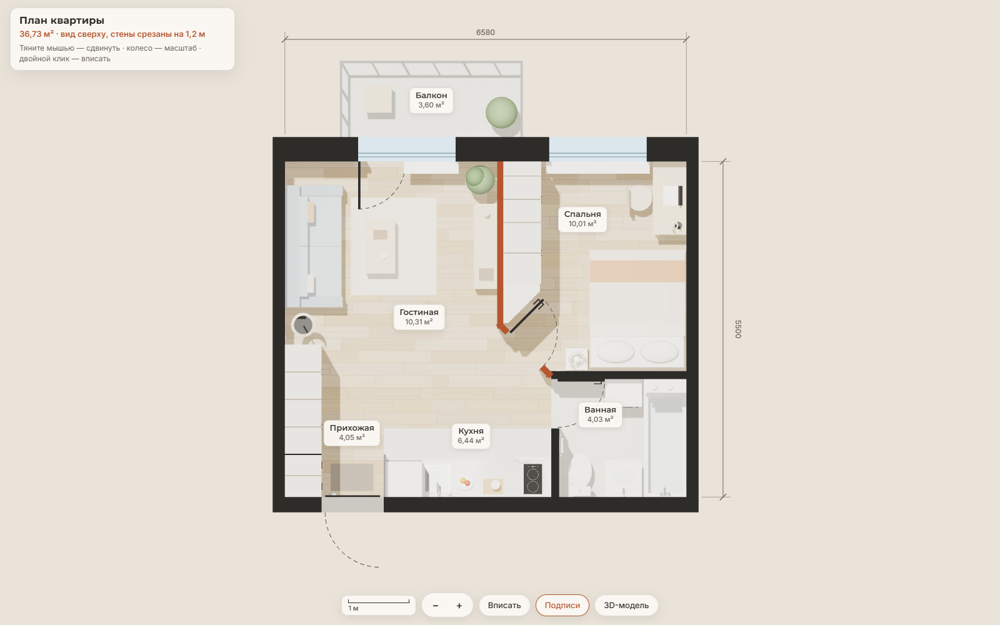
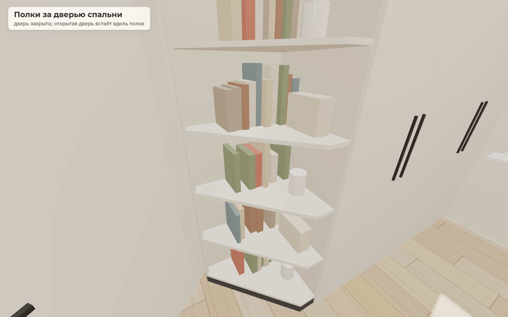
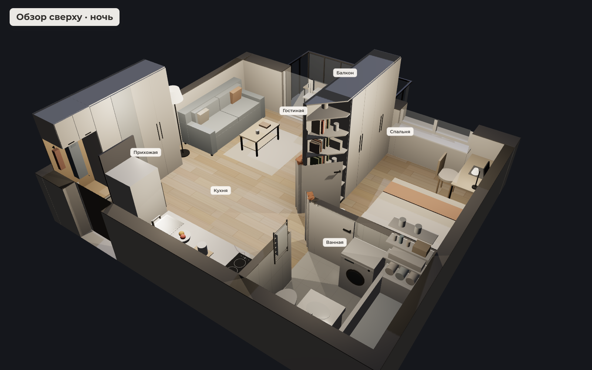
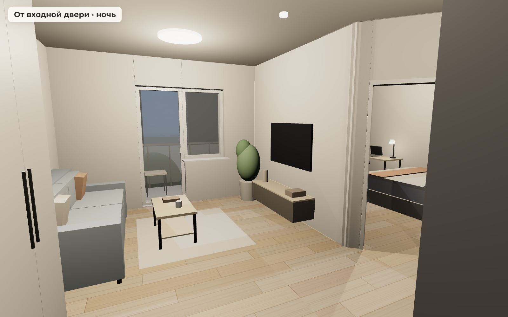

# Квартира в 3D

Квартира 36,73 м²: трёхмерная модель, план и схема розеток. Открывается в браузере, ничего устанавливать не нужно.

**Сайт:** https://artsiomdziominski.github.io/apartment-3d/ — на главной меню: что посмотреть.

| Страница | Что там |
|---|---|
| [3D-модель](https://artsiomdziominski.github.io/apartment-3d/3d.html) | обзор сверху и прогулка по комнатам; двери и дверцы шкафов открываются по нажатию, ночью свет включается выключателями |
| [План сверху](https://artsiomdziominski.github.io/apartment-3d/plan.html) | та же модель строго сверху: стены в разрезе на 1,2 м, площади комнат и общие размеры |
| [Электрика](https://artsiomdziominski.github.io/apartment-3d/electric.html) | где будут розетки и выключатели, на какой высоте, развёртки стен и линии в щитке |

## Управление

| Режим | Что делать |
|---|---|
| **Обзор** | Тяните мышью или пальцем — вращать; колесо или два пальца — масштаб; правая кнопка — сдвиг. Кнопка «Срез стен» опускает стены до 1,2 м. Нажмите на пол — встанете в этом месте. |
| **Прогулка** | Тяните — осмотреться; W A S D или стрелки — идти, Shift — быстрее; нажмите на пол — перейти туда. Сквозь стены и мебель не пройти. |
| **Двери и шкафы** | Нажмите на дверь спальни или ванной, на дверцу шкафа или кухонного шкафчика — откроется или закроется. Кухонные дверцы поднимаются вверх. |
| **Ночь и свет** | Кнопка «Ночь» внизу 3D-страницы (или клавиша N). Свет включается выключателями на стенах, как в квартире: Вк1 у входа — прихожая и кухня, Вк2 — гостиная, Вк3 у двери ванной — свет и подсветка зеркала, Вк4 — спальня. Вк5 у входной двери — мастер: гасит весь верхний свет. Торшер и лампы у кровати и на столе включаются нажатием на них. Ночью у выключенного выключателя светится подсветка. |
| **План** | Кнопка «План» внизу 3D-страницы. Тяните — сдвиг; колесо или два пальца — масштаб; двойной клик — вписать. «Подписи» скрывают названия комнат и размеры. |

Внизу 3D-страницы есть быстрые точки: Вход, Прихожая, Гостиная, Кухня, Спальня, Шкаф у окна, Полки за дверью, Ванная, Сверху. Каждую можно открыть сразу по ссылке, например `3d.html#kuhnya` или `3d.html#spalnya`.

## Что в планировке

- Прямая кухня вдоль стены: холодильник, мойка, посудомойка 45 см, индукционная панель на 2 конфорки по центру встроенной вытяжки, под ней духовка с функцией СВЧ (тумба 60 см). Верхние шкафы до потолка в два яруса, дверцы открываются вверх; у входа мебельная панель.
- Между гостиной и кухней пока свободно: обеденный стол, стулья и светильник над ними подберём позже.
- Прихожая: у входа слева открытая ниша 70 см — внизу тумба, выше крючки, наверху антресоль. Дальше шкаф 60×180 на четыре дверки, третья с зеркалом; в секции у ниши — щиток с автоматами.
- Спальня: шкаф 60×200. У окна неподвижная заглушка 24 см, потому что подоконник выступает на 20 см: так крайняя дверь открывается на 90° мимо него. Двери 38+38 и 50+50 см. Дверь в спальню открывается к шкафу, за ней полки со срезом под 45°.
- Ванная: дверь открывается внутрь к стене, ванна 170×70 вдоль дальней стены. Кран с изливом и душ на штанге — на торцевой стене у раковины, под раковиной подвесная тумба с ящиками. У другого торца, со стороны двери, — открытые полки в 23 см над коробом высотой с ванну, а рядом с ними стиральная машина 60×45: между открытой дверью и ванной.

Мебель условная: размеры и места по плану, без конкретных моделей.

## Электрика

28 розеток, 3 вывода (индукционная панель, подсветка столешницы, полотенцесушитель), 5 выключателей и щиток в шкафу прихожей. Выключатели на высоте 90 см: у входной двери — прихожая и кухня, у шкафа — гостиная, у двери ванной — свет и зеркало, у двери спальни — свет в спальне. У выхода мастер-выключатель: одной клавишей гасит весь свет в квартире. Номера на плане и на развёртках совпадают. Схема — ориентир: сечения, автоматы и УЗО окончательно подбирает электрик.

## План

Чертёж с мебелью и размерами:

## Скриншоты

| | |
|---|---|
|  Обзор сверху |  Обзор со стороны окон |
|  Сверху, как на плане |  От входной двери |
|  Прихожая: ниша у входа |  Гостиная |
|  Кухня из гостиной |  Кухня сбоку |
|  Спальня |  Шкаф в спальне: дверь мимо подоконника |
|  Полки за дверью спальни |  Ванная |
|  Ночь: свет горит по комнатам |  Ночь: вид от входной двери |

Модель сделана на [three.js](https://threejs.org/) r128, библиотека подключается с cdnjs.
