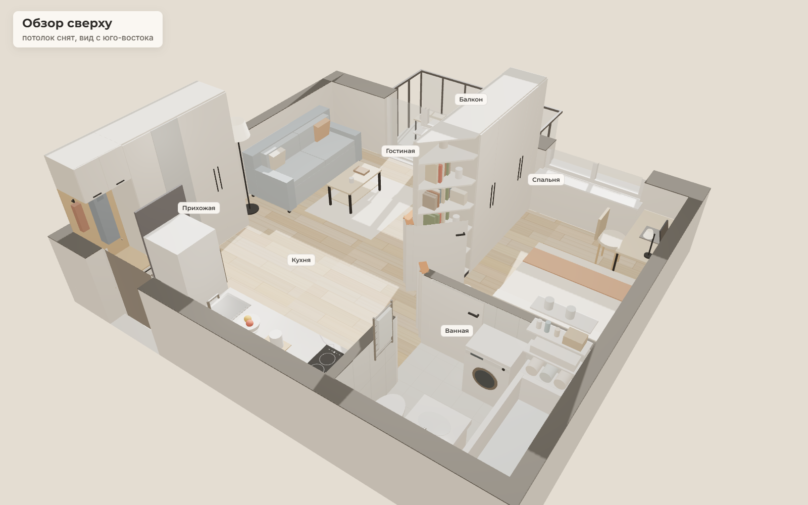
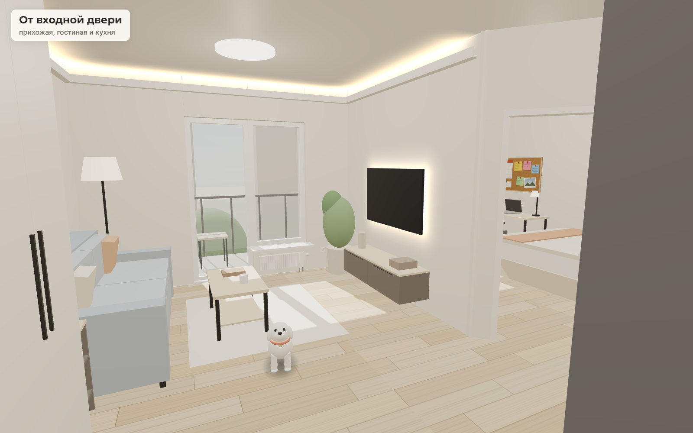
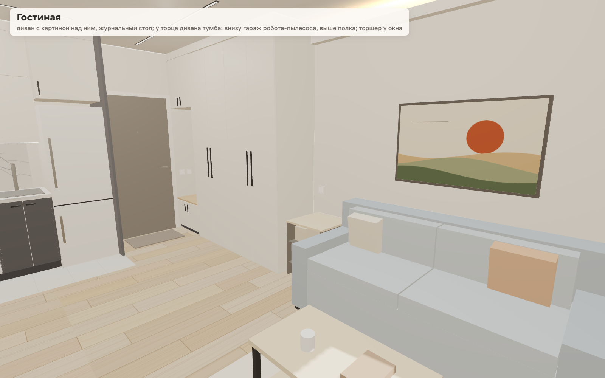
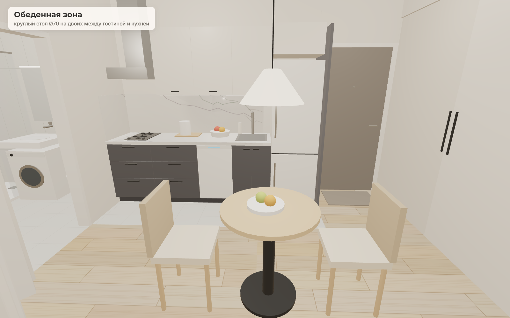

# Квартира в 3D

Трёхмерная модель квартиры. Открывается в браузере, ничего устанавливать не нужно.

**Открыть модель:** https://artsiomdziominski.github.io/apartment-3d/

## Управление

| Режим | Что делать |
|---|---|
| **Обзор** | Тяните мышью или пальцем — вращать; колесо или два пальца — масштаб; правая кнопка — сдвиг. Кнопка «Срез стен» опускает стены до 1,2 м. Нажмите на пол — встанете в этом месте. |
| **Прогулка** | Тяните — осмотреться; W A S D или стрелки — идти, Shift — быстрее; нажмите на пол — перейти туда. Сквозь стены и мебель не пройти. |
| **Двери** | Нажмите на дверь спальни или ванной — откроется или закроется. |

Внизу экрана есть быстрые точки: Вход, Гостиная, Кухня, Обеденная зона, Спальня, Полки за дверью, Ванная, Сверху. Каждую можно открыть сразу по ссылке, например `#kuhnya` или `#spalnya`.

## Что в планировке

- Прямая кухня вдоль стены: холодильник, мойка, посудомойка 45 см, газовая панель на 2 конфорки в 20 см от стены ванной; у входа мебельная панель.
- Круглый стол Ø70 на двоих между гостиной и кухней.
- Спальня: дверь открывается к шкафу, за открытой дверью — полки со срезом под 45°.
- Ванная: дверь открывается внутрь к стене, стиральная машина под раковиной, душ 70×193.

Мебель условная: размеры и места по плану, без конкретных моделей.

## План

## Скриншоты

| | |
|---|---|
|  Обзор сверху |  Обзор со стороны окон |
|  Сверху, как на плане |  От входной двери |
|  Гостиная |  Кухня из гостиной |
|  Кухня сбоку |  Обеденная зона |
|  Спальня |  Полки за дверью спальни |
|  Ванная | |

Модель сделана на [three.js](https://threejs.org/) r128, библиотека подключается с cdnjs.
