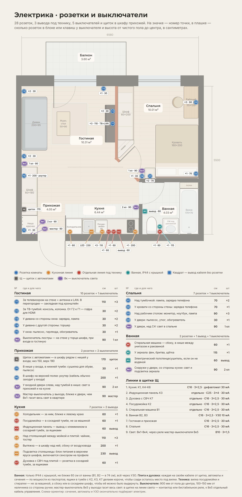
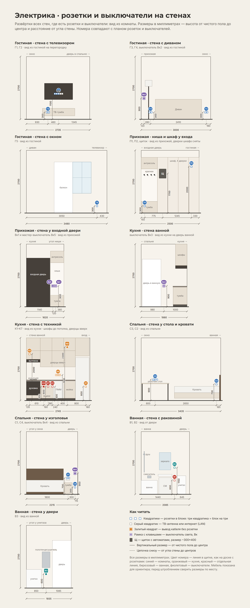
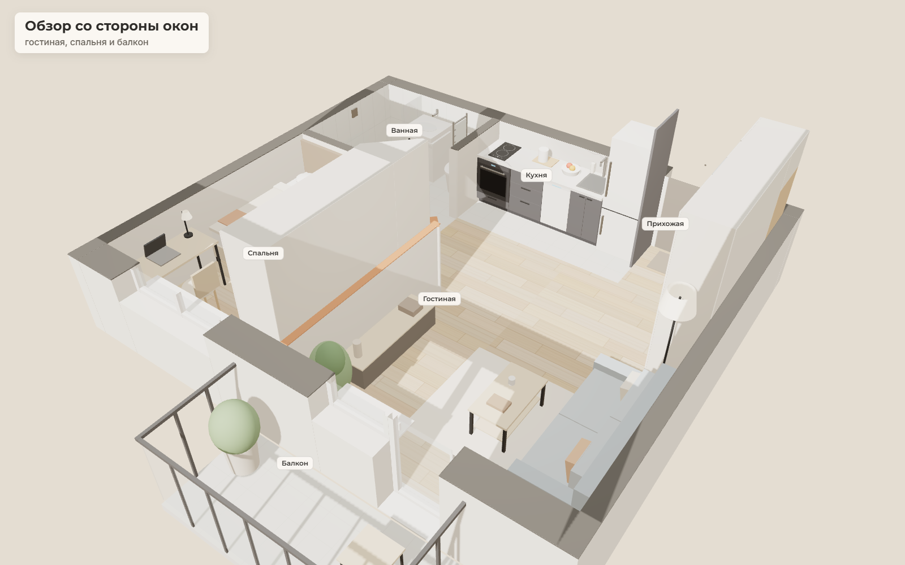
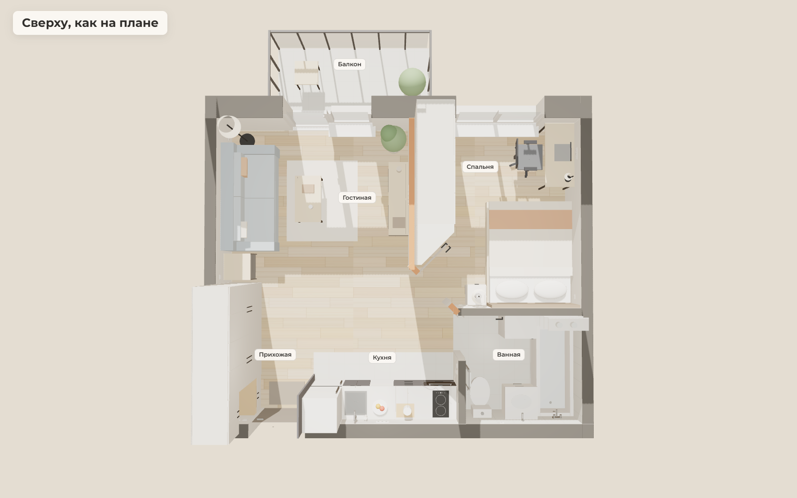
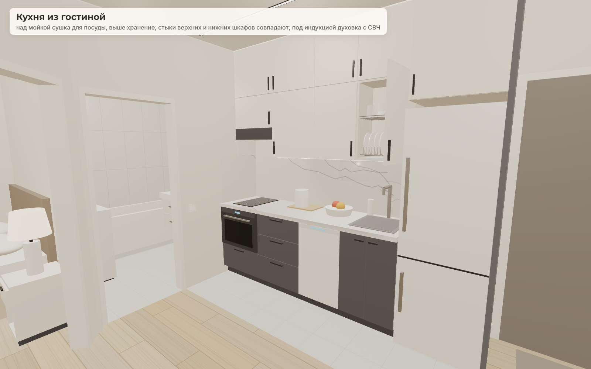
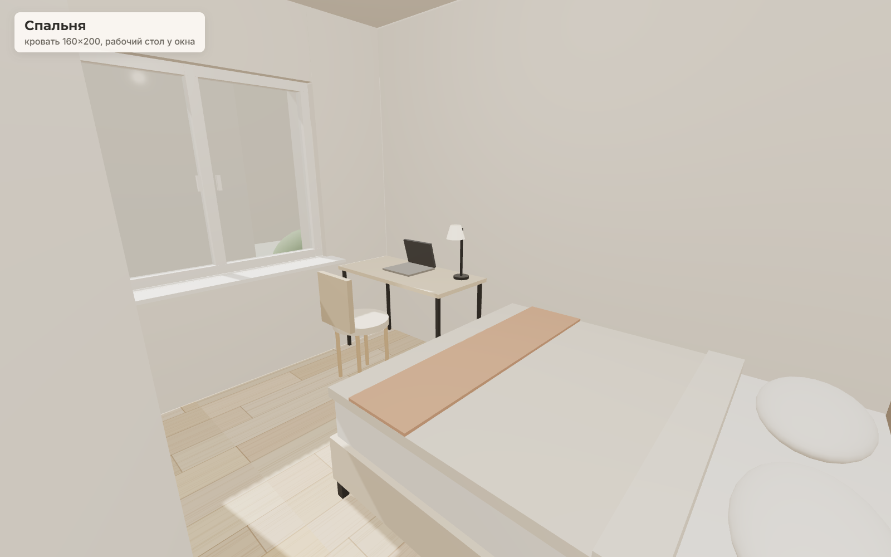
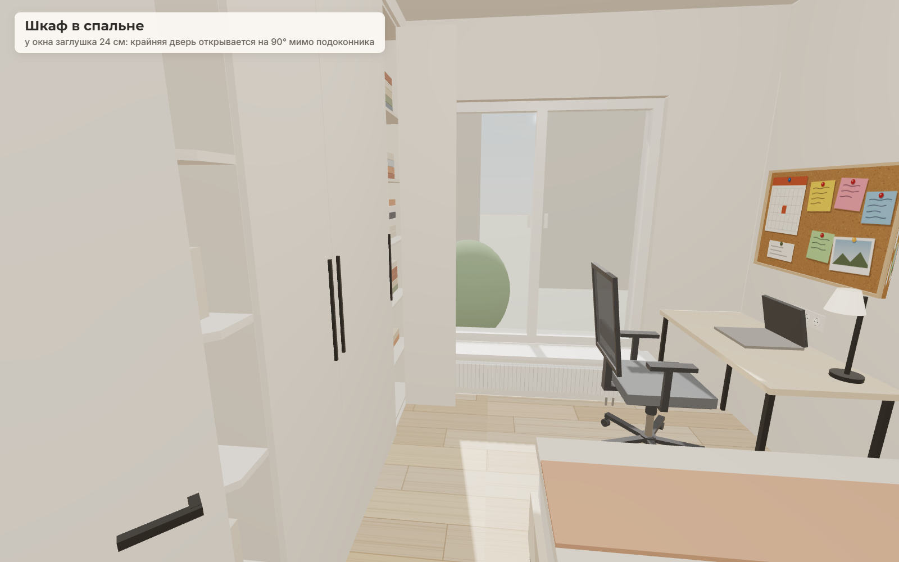
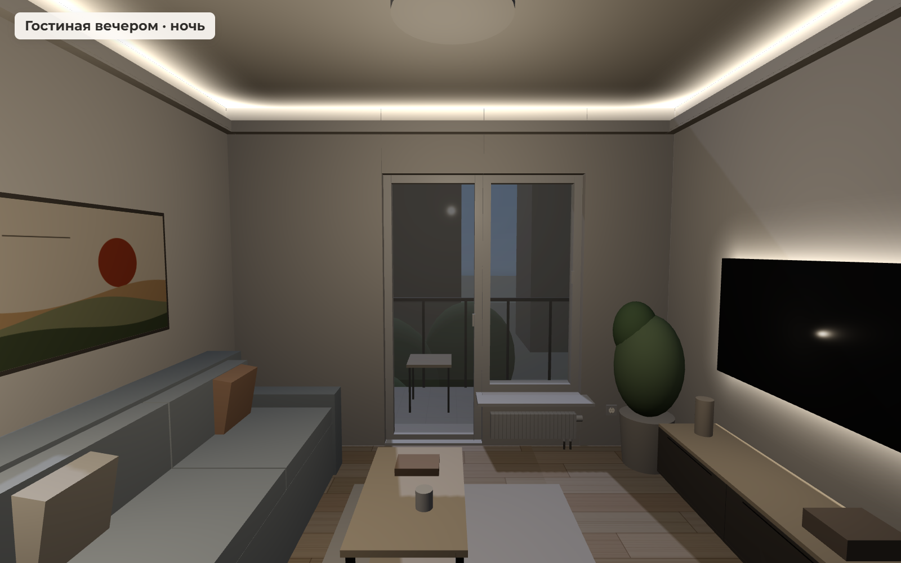
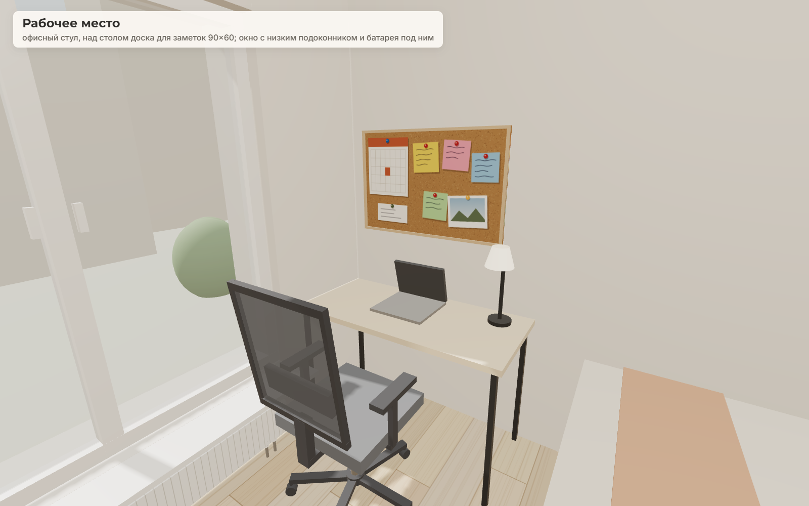

# Квартира в 3D

Квартира 36,73 м²: трёхмерная модель, план и схема розеток. Открывается в браузере, ничего устанавливать не нужно.

**Сайт:** https://artsiomdziominski.github.io/apartment-3d/ — на главной меню: что посмотреть.

| Страница | Что там |
|---|---|
| [3D-модель](https://artsiomdziominski.github.io/apartment-3d/3d.html) | обзор сверху и прогулка по комнатам; двери и дверцы шкафов открываются по нажатию, ночью свет включается выключателями; по квартире бегает собачка |
| [План сверху](https://artsiomdziominski.github.io/apartment-3d/plan.html) | та же модель строго сверху: стены в разрезе на 1,2 м, площади комнат, размеры стен, ширина проходов и размеры мебели |
| [Электрика](https://artsiomdziominski.github.io/apartment-3d/electric.html) | где будут розетки и выключатели, на какой высоте, развёртки стен и линии в щитке |
| [Размеры](https://artsiomdziominski.github.io/apartment-3d/razmery.html) | вверху план с размерами, дальше таблицы: стены и высоты (до потолка 2,7 м), техника, кухонные шкафы и мебель в сантиметрах, окна и двери, ширина проходов |
| [Дизайн-проект](https://artsiomdziominski.github.io/apartment-3d/proekt.html) | альбом из 32 листов А3 в PDF для бригады: визуализации, планы перегородок и мебели, двери и окна, сантехника, потолки, свет, розетки, полы, стены, развёртки, кухня и шкафы, коды цветов отделки и варианты. [Скачать PDF](proekt/dizain-proekt.pdf) |

## Управление

| Режим | Что делать |
|---|---|
| **Обзор** | Тяните мышью или пальцем — вращать; колесо или два пальца — масштаб; правая кнопка — сдвиг. Кнопка «Срез стен» опускает стены до 1,2 м. Нажмите на пол — встанете в этом месте. |
| **Прогулка** | Тяните — осмотреться; W A S D или стрелки — идти, Shift — быстрее; нажмите на пол — перейти туда. Сквозь стены и мебель не пройти. |
| **Двери и шкафы** | Нажмите на дверь спальни или ванной, на дверцу шкафа, тумбы или ящик — откроется или закроется. Открывается вся мебель с дверцами: кухня сверху и снизу, шкафы в прихожей и спальне (внутри штанга с одеждой и полки), тумба и антресоль в нише у входа, ТВ-тумба, тумба у кровати и тумба под раковиной. Верхние кухонные дверцы распашные, соседние открываются навстречу друг другу. |
| **Ночь и свет** | Круглая кнопка справа вверху 3D-страницы: луна — включить ночь, солнце — вернуть день (или клавиша N). Свет включается выключателями на стенах, как в квартире: Вк1 у входа — прихожая, Вк2 — гостиная: левая клавиша люстра, правая подсветка, Вк3 у двери ванной — свет и вытяжка, Вк6 рядом с ним — кухня, Вк4 — спальня. Вк5 у входной двери — мастер: гасит весь верхний свет. Торшер, лампы у кровати и на столе и подсветка зеркала включаются нажатием на них. Ночью у выключенного выключателя светится подсветка. |
| **Розетки** | Все розетки и выводы стоят в 3D на своих местах и высотах, номера как на доске электрики. Нажмите на розетку — внизу появится её номер, высота и для чего она. Часть закрыта мебелью, как и в жизни: Г1 за телевизором, Г2 и Г6 в ТВ-тумбе, К1 за холодильником. |
| **Собачка** | По квартире сама бегает маленькая белая собачка: обходит мебель, ходит через открытые двери, сидит, нюхает пол, ложится на ковёр в гостиной и у кровати, ждёт у входной двери и у холодильника. На прогулке иногда подбегает к вам и смотрит снизу вверх. Нажмите на неё — погладить: она повернётся к вам, завиляет хвостом и над ней поднимутся сердечки. Если закрыть дверь, собачка останется в своей комнате, пока её не откроют. |
| **Цвета** | Кнопка «Цвета» внизу 3D-страницы: краска стен, ламинат и фасады — настоящие коды из вееров NCS и RAL и каталога Egger, по 5–7 вариантов. Выбор сразу виден в 3D и запоминается; «Как в проекте» возвращает отделку проекта. |
| **Рулетка** | Кнопка «Рулетка»: нажмите на первую точку, потом на вторую — появится расстояние, а если точки на разной высоте, то отдельно по горизонтали и по высоте. Следующее нажатие начинает новый замер. С Shift вторая точка встаёт строго по горизонтали или вертикали; Esc — выйти. Мерить можно и в обзоре, и на прогулке. |
| **План** | Кнопка «План» внизу 3D-страницы. Тяните — сдвиг; колесо или два пальца — масштаб; двойной клик — вписать. «Подписи» скрывают названия комнат и размеры. |

Внизу 3D-страницы есть быстрые точки: Вход, Прихожая, Гостиная, Кухня, Спальня, Рабочее место, Шкаф у окна, Полки за дверью, Ванная, Сверху. Каждую можно открыть сразу по ссылке, например `3d.html#kuhnya` или `3d.html#spalnya`. Гостиная вечером, когда горит только подсветка, — `3d.html#podsvetka`.

## Что в планировке

- Прямая кухня вдоль стены: холодильник, мойка, посудомойка 45 см, индукционная панель на 2 конфорки по центру встроенной вытяжки. Под ней компактная духовка с функцией СВЧ 59,5×45,4×56,8 см — в нише 56,2×45×55,5 сразу под столешницей, ниже ящик 30 см для противней. Верхние шкафы в два яруса до 260 см, дверцы распашные, открываются вбок; стыки верхних шкафов совпадают с нижними: модули 50, 45, 56,5 и 60 см. Шкаф над мойкой разделён: внизу сушка для посуды без дна — решётка для тарелок, выше решётка для чашек и поддон, — над ней ярус для хранения. У входа мебельная панель от пола до потолка. Внизу под мойкой две дверцы (внутри сифон и ведро), рядом три выдвижных ящика: приборы, тарелки, кастрюли.
- Потолки натяжные, белые сатиновые, высота 2,7 м от чистого пола во всех комнатах. Свет на кухне и в прихожей — магнитные треки, встроенные в полотно заподлицо и целиком заполненные линейными модулями: получается одна сплошная светящаяся полоса, без спотов. Кухня: полоса 2,35 м вдоль шкафов, в 54 см от верхних фасадов. Прихожая: полоса 2,1 м по центру. Блоки питания 48 В: кухонный — в шкафу над холодильником (вывод К8), для прихожей — на антресоли над нишей (вывод П3). Прихожая включается выключателем Вк1 у входа, кухня — Вк6 в конце кухни, у двери ванной. Закладные, профили и кабели к свету ставят до монтажа полотна. Все шкафы — кухня, шкафы в прихожей и спальне, антресоль в нише, полки за дверью — заканчиваются на 260 см, выше одна и та же планка 10 см в цвет фасадов до потолка: к ней крепится профиль натяжного потолка, над шкафами полотно не натягивают.
- Гостиная: у торца дивана со стороны прихожей — тумба 50 × 50 × 62 по высоте подлокотника: внизу открытая ниша 13 см — гараж робота-пылесоса с зарядкой (розетка Г4 внутри), выше полка. Спереди свободно больше метра, и из центра квартиры робот одинаково легко доезжает до всех комнат. Торшер — у другого конца дивана, у окна, в Г3. Над диваном по центру висит картина 110×70, низ рамы на высоте 1,12 м — на 24 см выше спинки. Атмосферная подсветка — тёплая светодиодная лента 24 В, 2700 K: в карнизе на 12 см ниже потолка вдоль стен с диваном, окном и телевизором (около 9 м) и на задней стенке телевизора (около 3,4 м). Свет мягко ложится на потолок и на стену за ТВ; телевизор висит на кронштейне в 4 см от стены. Включается правой клавишей Вк2, блок питания примерно на 150 Вт — в ТВ-тумбе (вывод Г6).
- Между гостиной и кухней пока свободно: обеденный стол, стулья и светильник над ними подберём позже.
- Прихожая: у входа слева открытая ниша 70 см — внизу тумба, выше крючки, наверху антресоль. Дальше шкаф 60×180 на четыре одинаковые дверки; в секции у ниши — щиток с автоматами.
- Спальня: шкаф 60×200. У окна неподвижная заглушка 24 см, потому что подоконник выступает на 20 см: так крайняя дверь открывается на 90° мимо него. Двери 38+38 и 50+50 см. Дверь в спальню открывается к шкафу, за ней полки со срезом под 45°. У изголовья тумба 36×37 см высотой 50 см, на ней лампа 55 см с льняным абажуром Ø28. У окна рабочий стол 55×120 с офисным стулом на колёсах, над столом доска для заметок 90×60 в дубовой рамке, низ на 1,12 м.
- Окна: подоконники на высоте 42,5 см. Под ними низкие панельные батареи высотой 20 см — в гостиной 68 см, в спальне 130 см, в 10 см от пола и в 10 см от подоконника; подоконник выступает на 20 см и прикрывает их. Низкие батареи греют слабее высоких, поэтому мощность лучше сверить с теплопотерями комнат.
- Ванная: дверь открывается внутрь к стене, ванна 170×70 вдоль дальней стены. Кран с изливом и душ на штанге — на торцевой стене у раковины, под раковиной подвесная тумба с ящиками. Над унитазом, в углу за ним, — вытяжной вентилятор, полотенцесушитель водяной. У другого торца, со стороны двери, — открытые полки в 23 см над коробом высотой с ванну, а рядом с ними стиральная машина 60×45: между открытой дверью и ванной.

Мебель условная: размеры и места по плану, без конкретных моделей.

## Отделка

| Где | Что | Код |
|---|---|---|
| Стены: гостиная, кухня, прихожая, спальня | краска матовая моющаяся, тёплый светлый грейж | NCS S 1002-Y50R |
| Пол: гостиная, прихожая, спальня | ламинат «Дуб Шерман светлый» | Egger EPL183 |
| Фасады низа кухни, мебельная панель у входа | матовые, чёрно-серые | RAL 7021 |
| Фасады верха кухни, шкафы в прихожей и спальне, планка до потолка | матовые, кремово-белые | RAL 9001 |
| ТВ-тумба | матовая, серая умбра | RAL 7022 |

Варианты, которые переключаются кнопкой «Цвета»:

- **Стены:** NCS S 0502-Y тёплый белый, S 1005-Y20R светлый бежевый, S 1502-Y50R грейж, S 2005-G60Y шалфей, S 1502-B серо-голубой, S 1005-Y80R пудровый.
- **Пол:** Egger EPL190 «Дуб Мелба натуральный», EPL199 «Дуб Бейфорд белый», EPL195 «Дуб Марибор серый», EPL044 «Дуб Хантон тёмный».
- **Фасады:** все RAL 9010; низ Egger H1145 «Дуб Бардолино натуральный», RAL 7033, RAL 5008 или RAL 7044, верх и шкафы RAL 9001.

Цвета на экране приблизительные: перед покупкой сверьте с веером NCS или RAL и с образцом декора в магазине, стены — по выкраске. Светлые краски в ярком дневном свете модели почти сливаются, поэтому в 3D разница между ними усилена так, чтобы соответствовать вееру; цвет проекта показан как есть. Таблица и шесть вариантов кухни — на листе 32 дизайн-проекта.

## Электрика

28 розеток, 7 выводов (индукционная панель, подсветка столешницы, вытяжка в ванной, зеркало с подсветкой и три блока питания света: магнитные линии кухни и прихожей, подсветка гостиной), 6 выключателей и щиток в шкафу прихожей. Выключатели на высоте 90 см: у входной двери — прихожая, у шкафа — люстра и подсветка гостиной, у двери ванной — свет и вытяжка в ванной, рядом с ним, в конце кухни, — свет на кухне, у двери спальни — свет в спальне. Подсветка зеркала включается кнопкой на самом зеркале. У выхода мастер-выключатель: одной клавишей гасит весь свет в квартире. Номера на плане и на развёртках совпадают; там же таблица, какой свет от какого выключателя. Схема — ориентир: сечения, автоматы и УЗО окончательно подбирает электрик.

## План

Чертёж с мебелью и размерами:

## Скриншоты

| | |
|---|---|
|  Обзор сверху |  Обзор со стороны окон |
|  Сверху, как на плане |  От входной двери |
|  Прихожая: ниша у входа |  Гостиная |
|  Кухня из гостиной |  Кухня сбоку |
|  Спальня |  Шкаф в спальне: дверь мимо подоконника |
|  Полки за дверью спальни |  Ванная |
|  Ночь: свет горит по комнатам |  Ночь: вид от входной двери |
|  Вечер: горит только подсветка |  Рабочее место в спальне |

Модель сделана на [three.js](https://threejs.org/) r128, библиотека подключается с cdnjs.
